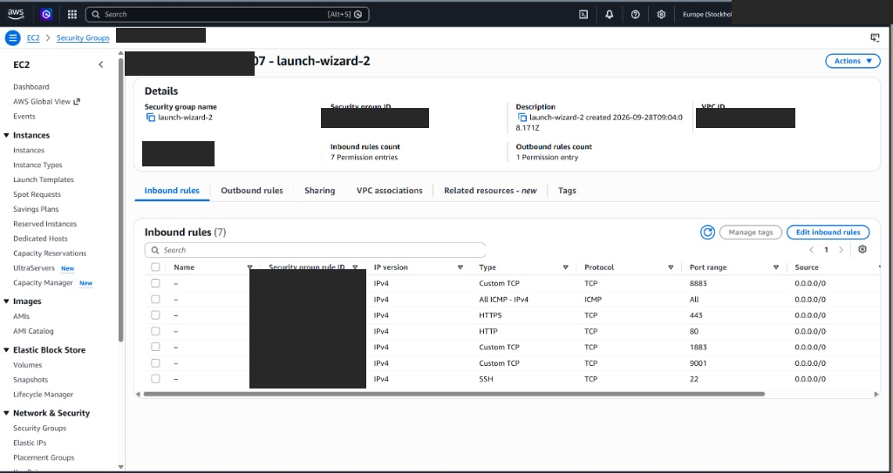
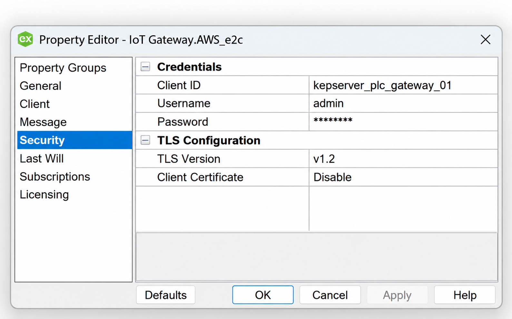
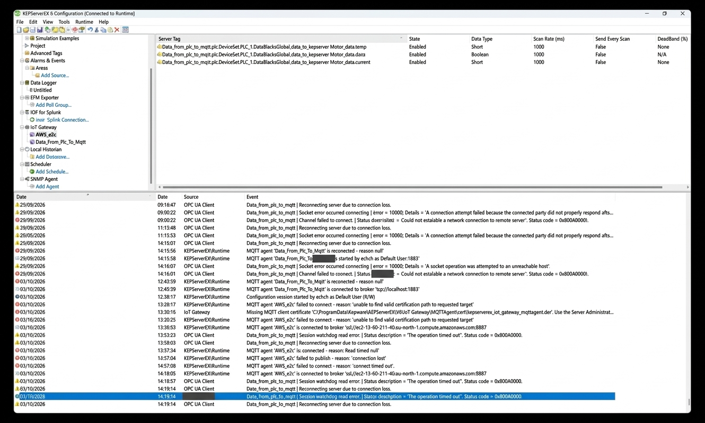
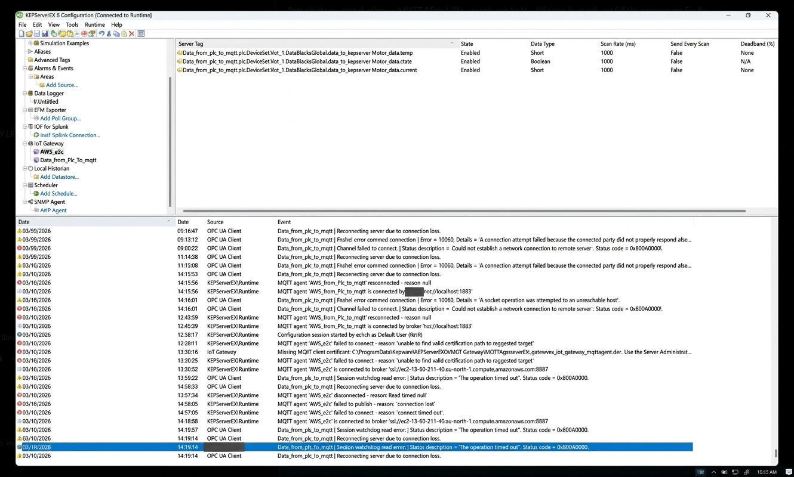

# Secure PLC → OPC UA → KEPServerEX → MQTT/TLS → AWS EC2

A reproducible OT-to-cloud lab showing how to:

- Read Siemens PLC data with OPC UA in KEPServerEX
- Publish KEPServer tags with the IoT Gateway MQTT agent
- Host a Mosquitto broker on AWS EC2
- Add MQTT username/password authentication
- Protect MQTT with TLS on port 8883
- Create a private CA and server certificate with OpenSSL
- Trust the CA on Windows/KEPServerEX
- Verify the broker with MQTTX
- Optionally test with Python Paho publisher/subscriber clients

> Security note: do not commit private keys, passwords, or live production credentials to GitHub.

## Final Architecture

```text
Siemens PLC
   │ OPC UA
   ▼
KEPServerEX
   │ IoT Gateway
   │ MQTT over TLS + Username/Password
   ▼
AWS EC2 (Ubuntu + Mosquitto :8883)
   │
   ├── MQTTX
   ├── Python Paho
   ├── Node-RED
   └── Other subscribers
```

## 1. Connect to EC2

On Windows PowerShell:

```powershell
cd C:\Users\<YOUR_USER>\Desktop\AWS_ec2
icacls .\Aws_ec2_keypair.pem /inheritance:r
icacls .\Aws_ec2_keypair.pem /grant:r "$($env:USERNAME):(R)"
ssh -i .\Aws_ec2_keypair.pem ubuntu@<EC2_DNS>
```


*EC2 instance overview. Use your own instance's public DNS in the commands and certificate SAN.*

## 2. Install Mosquitto and OpenSSL

```bash
sudo apt update
sudo apt install mosquitto mosquitto-clients openssl -y
sudo systemctl status mosquitto
```

## 3. Create MQTT credentials

```bash
sudo mosquitto_passwd -c /etc/mosquitto/passwd admin
sudo chown mosquitto:mosquitto /etc/mosquitto/passwd
sudo chmod 600 /etc/mosquitto/passwd
```

## 4. Create the CA

```bash
cd /etc/mosquitto
sudo mkdir -p certs
cd certs

sudo openssl genrsa -des3 -out ca.key 2048

sudo openssl req -new -x509 \
  -days 1833 \
  -key ca.key \
  -out ca.crt
```

Keep `ca.key` private. `ca.crt` is the public CA certificate distributed to clients.

## 5. Create the server certificate configuration

```bash
sudo vim /etc/mosquitto/certs/server.cnf
```

Use:

```ini
[req]
default_bits = 2048
prompt = no
default_md = sha256
req_extensions = req_ext
distinguished_name = dn

[dn]
CN = <EC2_DNS>

[req_ext]
subjectAltName = @alt_names

[alt_names]
DNS.1 = <EC2_DNS>
IP.1 = <EC2_PUBLIC_IP>
```

Save in Vim with:

```text
Esc
:wq
Enter
```

## 6. Create and sign the server certificate

```bash
sudo openssl genrsa -out server.key 2048

sudo openssl req -new \
  -key server.key \
  -out server.csr \
  -config server.cnf

sudo openssl x509 -req \
  -in server.csr \
  -CA ca.crt \
  -CAkey ca.key \
  -CAcreateserial \
  -out server.crt \
  -days 1000 \
  -sha256 \
  -extensions req_ext \
  -extfile server.cnf
```

Verify:

```bash
openssl x509 \
  -in server.crt \
  -noout \
  -subject \
  -issuer \
  -ext subjectAltName
```

The SAN must contain the same EC2 hostname used by clients.

## 7. Set certificate permissions

```bash
sudo chown mosquitto:mosquitto server.key server.crt
sudo chmod 600 server.key
sudo chmod 644 server.crt ca.crt
```

## 8. Configure Mosquitto TLS

Create:

```bash
sudo vim /etc/mosquitto/conf.d/secure-mqtt.conf
```

Use:

```conf
listener 8883
protocol mqtt

cafile /etc/mosquitto/certs/ca.crt
certfile /etc/mosquitto/certs/server.crt
keyfile /etc/mosquitto/certs/server.key

allow_anonymous false
password_file /etc/mosquitto/passwd
```

Restart and verify:

```bash
sudo systemctl restart mosquitto
sudo systemctl status mosquitto
sudo ss -lntp | grep 8883
```

## 9. AWS Security Group

Allow inbound:

```text
TCP 22   → My IP
TCP 8883 → My IP
```

Avoid exposing MQTT to `0.0.0.0/0` unless intentionally required.



*This image shows broad lab rules, including SSH and MQTT open to `0.0.0.0/0`, plus plaintext port 1883. Follow the restricted source-IP rules above; this image is not the recommended inbound configuration. Remove unused inbound rules.*

## 10. Copy the CA certificate to Windows

Run from Windows PowerShell:

```powershell
scp -i .\Aws_ec2_keypair.pem ubuntu@<EC2_DNS>:/etc/mosquitto/certs/ca.crt .
```

Do not copy `ca.key` or `server.key` to clients.

## 11. Test with MQTTX

Use:

```text
Host: <EC2_DNS>
Port: 8883
SSL/TLS: ON
CA: ca.crt
Username: admin
Password: <YOUR_PASSWORD>
Client ID: mqttx_windows_01
```

Subscribe to:

```text
#
```

for a first test, or later to your production topic.

## 12. Configure KEPServerEX OPC UA

For the detailed **S7-1500 server certificate / KEPServer Client Driver certificate exchange**, follow [OPC UA certificates and CA setup](docs/opcua-certificates.md). It explains both trust directions, TIA Portal and Kepware settings, and how this differs from the MQTT OpenSSL CA.

Connect KEPServerEX to the Siemens PLC as an OPC UA client.

Example PLC nodes:

```text
data_to_kepserver.Motor_data.temp
data_to_kepserver.Motor_data.current
data_to_kepserver.Motor_data.state
```

Confirm KEPServer can read the tags before configuring MQTT.

## 13. Configure the KEPServer IoT Gateway MQTT agent

Example:

```text
URL:
ssl://<EC2_DNS>:8883

Topic:
factory/plc1/data

QoS:
1

Format:
Wide Format

Client ID:
kepserver_plc_gateway_01

Username:
admin

Password:
<YOUR_PASSWORD>
```

Do not reuse MQTTX or Python Client IDs.



*Security settings reference: unique Client ID, MQTT credentials, TLS 1.2, and client certificate disabled for this server-authenticated TLS setup. This is the MQTT agent configuration; OPC UA application-certificate trust is configured separately.*

## 14. Trust the private CA on Windows

If KEPServer reports:

```text
unable to find valid certification path to requested target
```

import `ca.crt` into the Windows Local Computer trusted root store.

Administrator Command Prompt:

```cmd
certutil -addstore "Root" C:\path\to\ca.crt
```

Or use MMC:

```text
Certificates
→ Computer account
→ Local Computer
→ Trusted Root Certification Authorities
→ Certificates
→ Import
```

If Mosquitto uses server-side TLS plus username/password only, leave the KEPServer MQTT client certificate disabled.

A successful KEPServer event looks like:

```text
MQTT agent 'AWS_e2c' is connected to broker
'ssl://<EC2_DNS>:8883'
```

## 15. Subscribe from MQTTX

Subscribe to the exact KEPServer topic:

```text
factory/plc1/data
```

or use:

```text
#
```

for troubleshooting.

Change a PLC value and confirm the MQTT message arrives.


*The supplied MQTTX image displays PLC tag payloads on `Awse2c/data` with QoS 0. This tutorial uses `factory/plc1/data` and publisher QoS 1; match your subscription to the topic you configure. Received payloads alone do not demonstrate certificate verification settings.*

## 16. Optional Python Paho TLS publisher

Install:

```bash
pip install paho-mqtt
```

```python
import ssl
import paho.mqtt.client as mqtt

BROKER = "<EC2_DNS>"
PORT = 8883
TOPIC = "factory/test"
USERNAME = "admin"
PASSWORD = "<YOUR_PASSWORD>"
CA_FILE = "ca.crt"

client = mqtt.Client(
    mqtt.CallbackAPIVersion.VERSION2,
    client_id="python_publisher_01"
)

client.username_pw_set(USERNAME, PASSWORD)

client.tls_set(
    ca_certs=CA_FILE,
    cert_reqs=ssl.CERT_REQUIRED,
    tls_version=ssl.PROTOCOL_TLS_CLIENT
)

client.connect(BROKER, PORT, 60)
client.publish(TOPIC, '{"temperature": 25.4}', qos=1)
client.disconnect()
```

## 17. Optional Python Paho TLS subscriber

```python
import ssl
import paho.mqtt.client as mqtt

BROKER = "<EC2_DNS>"
PORT = 8883
TOPIC = "factory/#"
USERNAME = "admin"
PASSWORD = "<YOUR_PASSWORD>"
CA_FILE = "ca.crt"

def on_connect(client, userdata, flags, reason_code, properties):
    print("Connected:", reason_code)
    client.subscribe(TOPIC, qos=1)

def on_message(client, userdata, message):
    print(message.topic, message.payload.decode())

client = mqtt.Client(
    mqtt.CallbackAPIVersion.VERSION2,
    client_id="python_subscriber_01"
)

client.username_pw_set(USERNAME, PASSWORD)

client.tls_set(
    ca_certs=CA_FILE,
    cert_reqs=ssl.CERT_REQUIRED,
    tls_version=ssl.PROTOCOL_TLS_CLIENT
)

client.on_connect = on_connect
client.on_message = on_message

client.connect(BROKER, PORT, 60)
client.loop_forever()
```

## 18. Final pipeline

```text
PLC
↓
OPC UA
↓
KEPServerEX
↓
IoT Gateway
↓
MQTT over TLS :8883
↓
AWS EC2 Mosquitto
↓
MQTTX / Python / Node-RED / other subscribers
```

## 19. Troubleshooting

### TLS hostname mismatch

```text
ERR_TLS_CERT_ALTNAME_INVALID
```

Check:

```bash
openssl x509 -in /etc/mosquitto/certs/server.crt -noout -ext subjectAltName
```

The DNS SAN must match the hostname used by the client.

### KEPServer cannot validate the broker

```text
unable to find valid certification path to requested target
```

Import `ca.crt` into the Windows Local Computer Trusted Root Certification Authorities store.

### Session taken over

Give every MQTT client a unique Client ID.

### Password file cannot be opened

```bash
sudo chown mosquitto:mosquitto /etc/mosquitto/passwd
sudo chmod 600 /etc/mosquitto/passwd
```

### Supplied broker and KEPServer diagnostic images


*Broker diagnostic output includes TLS unexpected-EOF errors. It also shows manual process commands; use the systemd commands in this tutorial to manage the service.*



*Supplied KEPServer reference image showing tag configuration and connection/trust errors. The visible broker endpoint uses port 8887, whereas this tutorial uses 8883. The image contains a public EC2 hostname; review it before publishing. This image is not a clean acceptance-test result.*

<details>
<summary>Additional supplied KEPServer event-log image</summary>



*An additional supplied variant of the event-log view. Some text appears altered; use the written configuration and actual runtime diagnostics as the authoritative reference.*

</details>

## 20. Suggested GitHub repo structure

```text
secure-plc-mqtt-aws/
├── README.md
├── mosquitto/
│   └── secure-mqtt.conf.example
├── openssl/
│   └── server.cnf.example
├── python/
│   ├── publisher.py
│   └── subscriber.py
├── docs/
│   ├── architecture.png
│   ├── kepserver-config.png
│   └── mqttx-test.png
└── .gitignore
```

Recommended `.gitignore`:

```gitignore
*.key
*.pem
*.p12
*.pfx
*.csr
*.srl
passwd
pwfile*
.env
```

## Result

The completed OT-to-cloud path is:

```text
Siemens PLC
→ OPC UA
→ KEPServerEX
→ MQTT/TLS
→ AWS EC2 Mosquitto
→ MQTT subscribers
```

Security is split into two mechanisms:

```text
TLS certificate
→ server identity + encryption

MQTT username/password
→ client authentication
```
